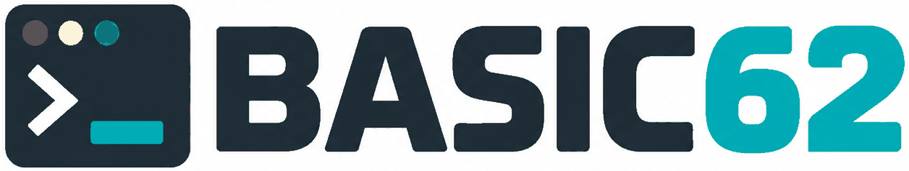
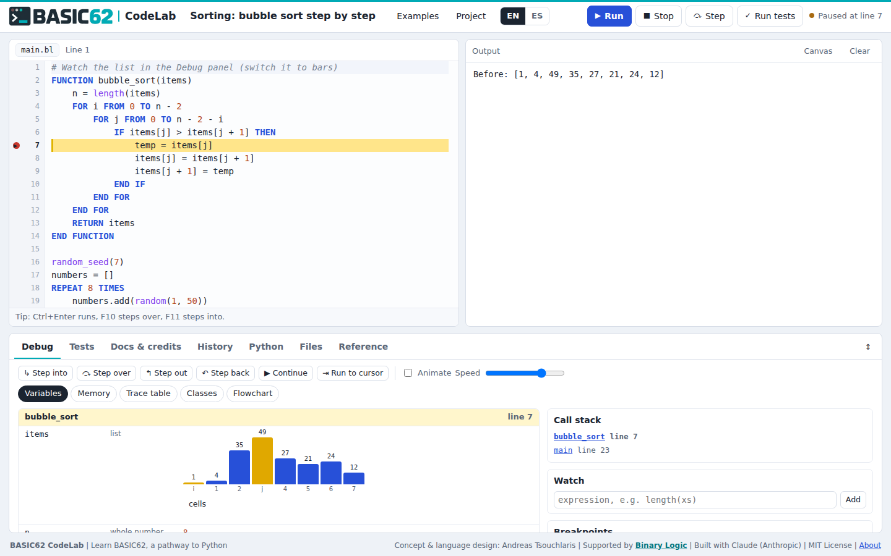
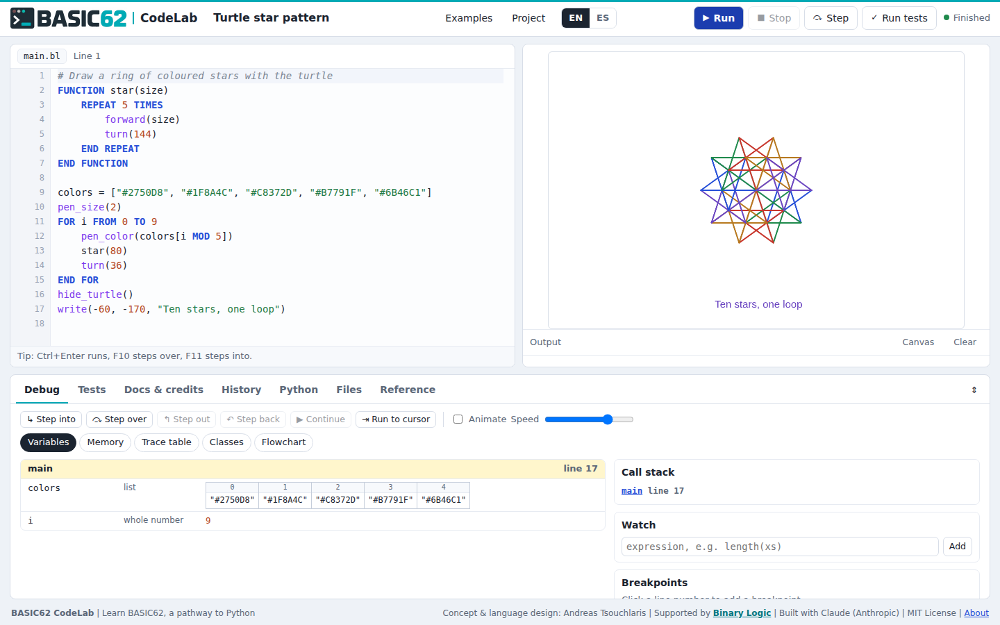
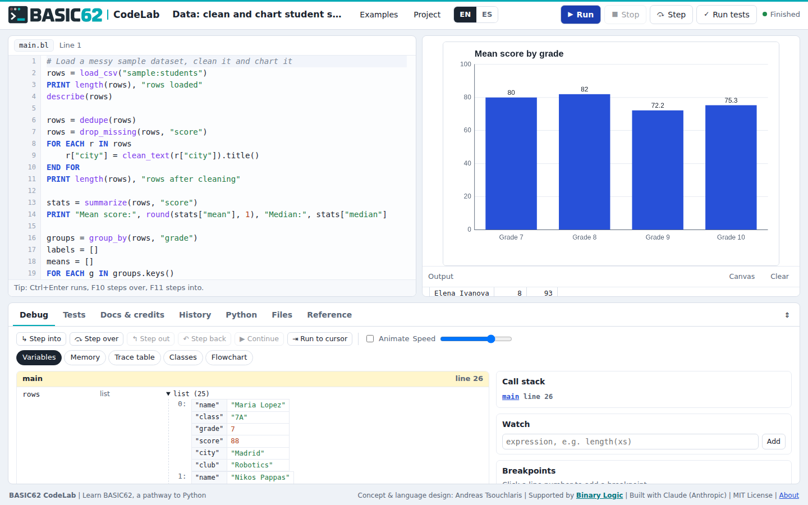

<p align="center"></p>

# BASIC62 CodeLab

*62 Years of BASIC. A New Pathway to Python.*

BASIC62 CodeLab is a browser-based educational programming environment for learning **BASIC62**, a modern, beginner-friendly language inspired by classic BASIC and designed to provide a progressive pathway to Python. BASIC62 stands for *Binary's Accessible Syntax for Introductory Computing*.

CodeLab is designed for Computer Science teachers and their students: it makes introductory programming accessible through highly readable syntax, introduces modern programming concepts step by step, and prepares students for the move to Python.

BASIC62 CodeLab was created in 2026 to celebrate the 62nd anniversary of BASIC and pays tribute to John G. Kemeny and Thomas E. Kurtz, who introduced BASIC at Dartmouth College on May 1, 1964. Their vision was to make programming accessible to everyone. BASIC62 builds on that educational philosophy, combining readable syntax with object-oriented programming, Python-style data structures and simulated API interactions.

The BASIC62 language and CodeLab were conceived and designed by **Andreas Tsouchlaris** with the support of **[Binary Logic](https://binarylogic.net)**, the publisher of K-12 Computing, Computer Science and AI Literacy teaching and learning resources. CodeLab is free and open-source software under the [MIT License](LICENSE).



## The main idea

Students who start with block-based tools such as Scratch often find the jump to a professional language like Python steep: indentation rules, unfamiliar error messages and many ways to do the same thing all arrive at once. BASIC62 and CodeLab offer a gentler middle path.

- **Start with readable code.** Every block opens with a keyword and closes with `END` and the same word, so the structure of a program is visible on the page.

  ```
  FOR i FROM 1 TO 5
      IF i MOD 2 == 0 THEN
          PRINT i, "is even"
      END IF
  END FOR
  ```

- **Introduce modern concepts gradually.** The same language grows with the student: lists and dictionaries, functions, classes with inheritance, error handling, data analysis, screen controls, simulated networks and cybersecurity, and simulated web APIs through function calls.
- **Build a natural pathway to Python.** Every program can be viewed and downloaded as Python, with tests as pytest functions and documentation as docstrings, so students compare two versions of code they already understand.
- **Teach good habits from the first lesson.** Tests, documentation, credits and version history are part of the language and of CodeLab rather than separate tools for later.

BASIC62 does not aim simply to reproduce classic BASIC. It extends BASIC's original educational purpose into modern Computer Science education, so students can progress beyond elementary programming without abandoning a familiar, readable syntax.

## Use in K-12 Computer Science education and beyond

BASIC62 CodeLab is designed for students in grades 7 to 10 (ages about 12 to 16), with one language serving all four years: a small core in the first year and new features each year after. It also suits older beginners, for example introductory programming in upper secondary school, teacher training, or a first programming course in higher education, where readable syntax and visible execution help students focus on algorithms and computational thinking.

Typical classroom uses:

- **First programs** with `PRINT`, `ASK`, decisions, loops and turtle graphics.
- **Seeing how code runs** with step-by-step execution, breakpoints, a variables view, a memory diagram, trace tables, flowcharts and class diagrams.
- **Working with data**: cleaning a messy CSV file, summarising it and charting it.
- **Systems and security**: routing packets through a simulated network, writing a firewall as a class, experimenting with ciphers, hashing and password strength.
- **Professional practice**: writing tests and a test plan, documenting functions, crediting sources and licences, and saving versions with a simplified git.
- **Moving to Python** by reading the automatic Python translation of a familiar program.

The [Teacher's Guide](docs/teacher-guide.md) contains a suggested progression by grade, lesson notes for the ten built-in examples and assessment ideas.

## Features

**The BASIC62 language**

- BASIC-inspired, readable syntax with explicit block endings; keywords are not case-sensitive, names are.
- Dynamic typing with whole numbers, decimals, text, `TRUE`/`FALSE`, `NOTHING`, lists, dictionaries and objects.
- Functions with default parameters; classes with `INIT`, `SELF`, `EXTENDS` and `PARENT`.
- `TRY ... ON ERROR` and `FAIL` for error handling.
- `TEST` blocks with `EXPECT`, `EXPECT ERROR ... CONTAINS` and `WITH INPUTS`.
- `DOC` blocks whose examples are checked automatically.
- 111 built-in functions: core, text, turtle and drawing, screen controls, web data from offline samples, data tools and charts, a simulated network, security, and testing helpers.
- English and Spanish editions with one-click conversion of a whole project.
- Error messages in plain language, with the line, a suggestion and a "why" explanation.

**The CodeLab environment**

- Code editor with syntax colouring, automatic indentation, automatic `END` lines and a context help bar.
- Stage with a canvas (turtle, shapes, charts, animated network diagrams), screen controls and an output console.
- Debugger: step into, over, out and back, continue, run to cursor, animation, breakpoints and conditional breakpoints, watches, call stack.
- Visualizations: variables (lists as cells or bars with index markers), memory diagram with references, trace table with CSV export, class diagram, flowchart.
- Tests tab with results, DOC example checks, code coverage and a test plan.
- Docs and credits tab with a generated project reference, documentation checker, About page and a credits table with licences.
- History tab: a simulated git with commits, diffs, restore, revert, branches, merges with conflict resolution gated by tests, tags, push and pull, staging and a git console.
- Python tab with automatic translation and a zip download.
- Files tab for CSV and text files, plus built-in sample datasets.
- Searchable reference of every keyword, function and method in both editions.
- Projects saved in the browser, with export and import as JSON.

The complete list of keywords, functions, methods, classes and error messages is in the [language reference](docs/language-reference.md), which is generated from the source code.

| | |
| --- | --- |
|  |  |

## Quick start

BASIC62 CodeLab is a single, self-contained web page.

- **Use it directly:** open `index.html` in a current browser (Chrome, Edge, Firefox or Safari). No server or installation is needed.
- **Host it:** publish the repository with GitHub Pages (or any static web host) and share the link with students.

Projects are saved in each student's browser. Students hand in work with **Project → Export project (.json)**, and teachers open it with **Project → Import project**.

## Building from source

The source is plain JavaScript, HTML and CSS with no dependencies. A small Python script assembles the single-file app.

```
python3 build.py          # writes dist/core.js, dist/index.html and ./index.html
node test/core.test.js    # 149 tests of the language engine
```

With npm the same steps are `npm run build` and `npm test`.

Optional browser tests use Playwright:

```
pip install playwright
python -m playwright install chromium
python3 test/e2e_smoke.py          # add --shots to save screenshots
```

To regenerate the language reference after changing the engine:

```
node tools/gen_reference.js
```

## Repository structure

```
index.html                 built app, ready to open or host
LICENSE                    MIT License
assets/                    logo, header logo and favicon
build.py                   assembles dist/ and index.html from src/
src/
  c1_lex.js                utilities, editions, messages, lexer
  c2_parse.js              parser
  c3_run.js                interpreter (step-by-step execution, debugging hooks)
  c4_lib.js                standard library
  c5_netsec.js             simulated network and security
  c6_tools.js              tests, docs checker, Python translation, editions, history
  c7_samples.js            sample data and example programs
  api.js                   public engine interface
  ui1.js ... ui5.js        user interface
  style.css, index.tpl.html
test/
  core.test.js             engine tests (Node)
  e2e_smoke.py             browser tests (Playwright)
tools/gen_reference.js     generates docs/language-reference.md
docs/
  introduction-for-schools.md
  teacher-guide.md
  student-guide.md
  language-reference.md
  images/
```

## Documentation

- [Introduction for teachers and IT coordinators](docs/introduction-for-schools.md): what BASIC62 CodeLab is, how it compares with familiar languages, and practical requirements.
- [Teacher's Guide](docs/teacher-guide.md): progression for grades 7 to 10, lesson notes, debugging pedagogy, testing, coaching through errors, assessment.
- [Student Guide](docs/student-guide.md): a self-study guide with tested examples, debugging techniques and challenges.
- [Language reference](docs/language-reference.md): every keyword, built-in function, method, class and error message, in English and Spanish.

## Status and known limitations

**Development status:** Prototype | BASIC62 Language Specification v0.1

BASIC62 CodeLab is a **prototype** following BASIC62 language specification v0.1. The features listed above are implemented and covered by the engine and browser tests in this repository; the educational effectiveness of BASIC62 CodeLab has not yet been evaluated in classrooms.

Current limitations:

- Programs can only use the built-in `sample:` web APIs and datasets, and uploaded files; they cannot fetch live websites.
- Recursion is limited to 500 nested calls, below the 1,000 in the specification, because of browser stack limits.
- Step back in the debugger replays typed answers but not clicks or timers.
- In the Spanish edition, `Y` and `O` must be written in capitals, library results use English data keys, and reference descriptions are in English.
- The Python helper module `blstudent.py` covers data, charts, turtle shapes and security, but not the simulated network or screen controls.
- The interface is available in English and Spanish.
- Projects are stored in the browser's local storage; there is no account system or live collaboration.
- Web fonts (Atkinson Hyperlegible and Fira Code) load from Google Fonts; without a connection the app uses system fonts.

## Privacy

BASIC62 CodeLab runs entirely in the browser. Student programs and projects are stored locally on the device and are not sent to a server by the application. The only external request is for the web fonts from Google Fonts; removing the font link in `src/index.tpl.html` makes the app fully self-contained.

## Feedback

Any corrections or suggestions are always welcome. Please open an issue or a pull request in this repository.

## License and Credits

Copyright (c) 2026 Andreas Tsouchlaris.

BASIC62 CodeLab is released under the MIT License. It is free and open-source software that anyone can use, modify, and distribute, including for educational and commercial purposes, subject to the license terms.

### Project Credits

**Original Concept, BASIC62 Language Design & Educational Direction:** Andreas Tsouchlaris

**Supported by:** [Binary Logic](https://binarylogic.net)

**AI-Assisted Software Implementation:** Claude (Anthropic)

BASIC62 CodeLab was created to celebrate the 62nd anniversary of BASIC (1964–2026), honoring the educational vision of John G. Kemeny and Thomas E. Kurtz at Dartmouth College.

BASIC62 CodeLab is an independent educational project. It is not affiliated with or endorsed by Dartmouth College, or by any organization or individual that created, published or maintains a version or dialect of BASIC.

The BASIC62 and BASIC62 CodeLab names and logos identify the original project. The MIT License does not grant trademark rights or permission to imply official endorsement by the project creators or Binary Logic.

See the [LICENSE](LICENSE) file for the full license terms.
